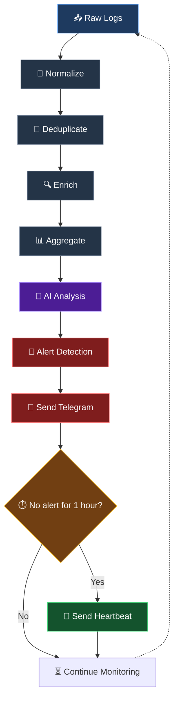

# SOC-AI

SOC-AI is an automated security log analysis pipeline that ingests FortiGate firewall logs, enriches them with threat intelligence, analyzes them with an LLM, and sends real-time alerts to Telegram when threats are detected.





---

## 1. Pipeline Stages

| # | Stage | Module | Input | Output |
|---|-------|--------|-------|--------|
| 1 | Normalize | `soc_ai.normalized` | Raw FortiGate syslog | `NormalizedLog` JSONL |
| 2 | Deduplicate | `soc_ai.dedup` | NormalizedLog JSONL | `DeduplicatedLog` JSONL |
| 3 | Enrich | `soc_ai.enrichment` | DeduplicatedLog JSONL | `EnrichedLog` JSONL |
| 4 | Aggregate | `soc_ai.aggregation` | EnrichedLog JSONL | `AggregatedLog` JSONL (tumbling time windows; 3 min in `main.py`) |
| 5 | AI Analysis | `soc_ai.ai` | AggregatedLog JSONL | `AnalyzedLog` JSONL |
| 6 | Alert Detection | `soc_ai.alert` | AnalyzedLog JSONL | AlertEvent / HeartbeatEvent JSONL |
| 7 | Send Telegram | `soc_ai.telegram` | Events JSONL | Telegram messages |

### Alert Detection Logic

- **Alert** — When `verdict.should_alert == True`, an `AlertEvent` is created and sent to Telegram immediately.
- **Heartbeat** — When 1 hour passes with no alerts, a `HeartbeatEvent` (liveness message) is sent to confirm the pipeline is still running.
- The 1-hour timer is persisted to `.cache/alert_state.json` so it survives across pipeline runs.
- `main.py` (the orchestrator) overrides these defaults: it runs every 3 minutes with 3-minute aggregation windows and a 3-minute heartbeat interval.

---

## 2. Project Structure

```
soc-ai/
├── raw_logs/
│   └── 03_fortigate_firewall.txt
├── output/
│   ├── normalized_fortigate.jsonl
│   ├── deduplicated_fortigate.jsonl
│   ├── enriched_fortigate.jsonl
│   ├── aggregated_fortigate.jsonl
│   ├── analyzed_fortigate.jsonl
│   ├── alerts_fortigate.jsonl
│   └── ai_verdict_cache.json        # LLM verdict cache (auto-generated)
├── soc_ai/
│   ├── normalized/
│   │   ├── schemas.py
│   │   ├── normalizer.py
│   │   ├── pipeline.py
│   │   └── parsers/fortigate.py
│   ├── dedup/
│   │   ├── schemas.py
│   │   ├── deduplicator.py
│   │   └── pipeline.py
│   ├── enrichment/
│   │   ├── schemas.py
│   │   ├── cache.py
│   │   ├── ip_utils.py
│   │   ├── pipeline.py
│   │   ├── providers/
│   │   │   ├── abuseipdb.py
│   │   │   └── virustotal.py
│   │   └── normalizers/
│   │       └── virustotal_normalizer.py
│   ├── aggregation/
│   │   ├── schemas.py
│   │   ├── aggregator.py
│   │   └── pipeline.py
│   ├── ai/
│   │   ├── schemas.py
│   │   ├── analyzer.py
│   │   ├── context_loader.py
│   │   ├── pipeline.py
│   │   └── context/
│   │       ├── 01_environment.md
│   │       ├── 02_detection_policy.md
│   │       ├── 03_asset_criticality.md
│   │       ├── 04_known_benign_patterns.md
│   │       ├── 05_response_playbooks.md
│   │       └── 06_output_schema.md
│   ├── alert/
│   │   ├── schemas.py
│   │   ├── detector.py
│   │   └── pipeline.py
│   └── telegram/
│       ├── schemas.py
│       ├── sender.py
│       └── pipeline.py
├── .cache/
├── .env / .env.example
├── requirements.txt
└── README.md
```

---

## 3. Setup

```bash
python -m venv .venv
```

Windows PowerShell:
```powershell
.\.venv\Scripts\Activate.ps1
```

Install dependencies:
```bash
pip install -r requirements.txt
```

Configure environment variables:
```bash
cp .env.example .env
# Edit .env with your API keys and Telegram credentials
```

---

## 4. Configuration

All configuration is managed in `.env`:

### Threat Intelligence
| Variable | Description |
|----------|-------------|
| `ABUSEIPDB_API_KEY` | AbuseIPDB API key (required for enrichment) |

### LLM Provider

Any OpenAI-compatible endpoint works — switching providers only requires editing `.env`, no code changes.

| Variable | Description |
|----------|-------------|
| `LLM_PROVIDER` | Provider: `groq`, `deepseek`, `openrouter`, `together`, `openai`, `custom` |
| `LLM_API_KEY` | API key (used when `LLM_PROVIDER=custom`) |
| `LLM_BASE_URL` | OpenAI-compatible base URL (used when `LLM_PROVIDER=custom`) |
| `LLM_MODEL` | Model name (used when `LLM_PROVIDER=custom`) |
| `<PROVIDER>_API_KEY` | API key for built-in providers (e.g. `GROQ_API_KEY`, `DEEPSEEK_API_KEY`) |
| `<PROVIDER>_MODEL` | Optional model override for built-in providers |
| `LLM_TEMPERATURE` | Sampling temperature (default: 0.2) |
| `LLM_MAX_TOKENS` | Max completion tokens (default: 1024) |

Example — custom provider (RevidAPI):

```env
LLM_PROVIDER=custom
LLM_API_KEY=your_revidapi_api_key
LLM_BASE_URL=https://revidapi.com/v1
LLM_MODEL=deepseek-v4-pro
```

### Telegram Notification
| Variable | Description |
|----------|-------------|
| `TELEGRAM_BOT_TOKEN` | Bot token from @BotFather (required) |
| `TELEGRAM_CHAT_ID` | Target chat ID (required) |
| `TELEGRAM_DRY_RUN` | Set `true` to print messages without sending (default: `true`) |
| `TELEGRAM_SEND_DELAY` | Delay between messages in seconds (default: 0.5) |

### How to create a Telegram bot

1. Open Telegram, search **@BotFather** → send `/newbot`
2. Choose a display name and username (must end in `bot`)
3. Copy the bot token → set `TELEGRAM_BOT_TOKEN`
4. Open your bot → click **Start**
5. Get your chat ID via: `https://api.telegram.org/bot<TOKEN>/getUpdates`
6. Set `TELEGRAM_CHAT_ID` and `TELEGRAM_DRY_RUN=false`

---

## 5. Run

### Orchestrator (recommended)

```powershell
python .\main.py
```

Runs all 7 stages in a continuous loop (every 3 minutes), sends alerts to Telegram, and emits a heartbeat when no alert occurs within `HEARTBEAT_INTERVAL_HOURS` (default: 3 minutes). Stop with **Ctrl+C** — the process exits within ~0.5 seconds even in the middle of an LLM/HTTP request (each cycle runs in a daemon thread).

### Run each stage individually

From the project root:

```powershell
python -m soc_ai.normalized.pipeline  raw_logs/03_fortigate_firewall.txt  output/normalized_fortigate.jsonl
python -m soc_ai.dedup.pipeline       output/normalized_fortigate.jsonl   output/deduplicated_fortigate.jsonl
python -m soc_ai.enrichment.pipeline  output/deduplicated_fortigate.jsonl output/enriched_fortigate.jsonl
python -m soc_ai.aggregation.pipeline output/enriched_fortigate.jsonl     output/aggregated_fortigate.jsonl
python -m soc_ai.ai.pipeline          output/aggregated_fortigate.jsonl   output/analyzed_fortigate.jsonl
python -m soc_ai.alert.pipeline       output/analyzed_fortigate.jsonl     output/alerts_fortigate.jsonl
python -m soc_ai.telegram.pipeline    output/alerts_fortigate.jsonl
```

### Alert Detection options

```powershell
# Default: 1-hour heartbeat interval
python -m soc_ai.alert.pipeline output/analyzed_fortigate.jsonl output/alerts_fortigate.jsonl

# Custom heartbeat interval (e.g. 0.5 hours)
python -m soc_ai.alert.pipeline output/analyzed_fortigate.jsonl output/alerts_fortigate.jsonl --heartbeat-interval 0.5
```

### Telegram options

```powershell
# Dry-run (print only, no real sending)
python -m soc_ai.telegram.pipeline output/alerts_fortigate.jsonl --dry-run

# Real send (TELEGRAM_DRY_RUN must also be false in .env)
python -m soc_ai.telegram.pipeline output/alerts_fortigate.jsonl
```

---

## 6. AI Verdict Cache

LLM verdicts are cached per `(model, window content)` in `output/ai_verdict_cache.json`, so re-running on the same logs does **not** call the LLM again.

How it works:

- **First cycle** — every window is analyzed by the LLM; each verdict is stored in the cache (written atomically right after the call, so a Ctrl+C mid-cycle never loses verdicts already paid for).
- **Later cycles** — a window whose content is unchanged is served from the cache: **no LLM call, 0 tokens**:

```text
[cache] verdict reused — no LLM call
[+] Analysis summary: windows=10, alerts=6, fallbacks=0, cached=10, total_tokens=0, tokens_saved=91756
```

- Cached verdicts are **stable across runs** (same severity / category / dedup_key), which also prevents duplicate "ghost" alerts caused by LLM non-determinism.
- Fallback verdicts (`analysis_failed`) are **never cached** — failed windows are retried automatically on the next cycle.
- New or changed logs produce new window content → analyzed normally once, then cached.
- Event IDs are derived from the log content (SHA-1) instead of a random UUID, so identical input always produces identical windows — this is what makes cache hits reliable (10/10 on static logs).

To force a full re-analysis, delete the cache file:

```powershell
del output\ai_verdict_cache.json
```

---

## 7. Alert & Heartbeat Format

### Alert Message (Telegram)

```text
🟡 [MEDIUM] TCP Port Scan Detected

Summary: A TCP port scan was detected from 10.2.11.24 to 17.57.154.7 on port 993...

Category: reconnaissance
Confidence: 70%
Window: 2026-06-15T07:55:00+08:00 -> 2026-06-15T08:00:00+08:00
Events: 1 | Malicious IPs: 0
Source: fortigate

Recommended Actions:
  1. Monitor the source IP 10.2.11.24...
```

### Heartbeat Message (Telegram)

```text
💓 SOC-AI Heartbeat

🛡️ No alerts in the last 1.0 hour(s)

Windows processed: 12
Events processed: 48
Last alert at: 2026-06-15T08:00:00+08:00
```

---

## 8. Severity & Reputation Mapping

### Severity (from AbuseIPDB confidence score)

```text
confidence_score >= 90  -> critical
confidence_score >= 70  -> high
confidence_score >= 30  -> medium
confidence_score > 0    -> low
otherwise               -> none
```

### Reputation

```text
confidence_score >= 70              -> malicious
confidence_score > 0 or reports > 0 -> suspicious
otherwise                           -> benign
```

---
